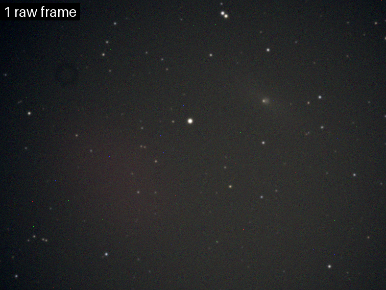
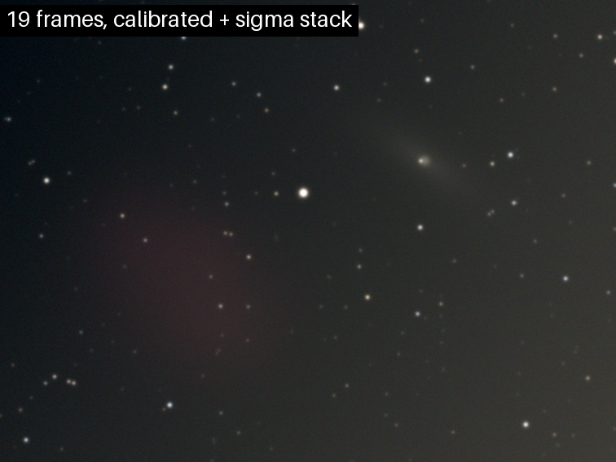
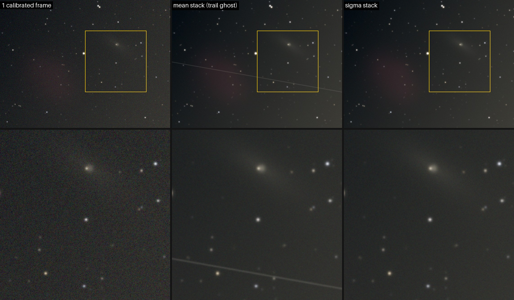

# astro-stack

Align and stack astrophotography frames shot with a phone through a small telescope, so twenty noisy frames become one clean image.

| One raw frame | 19 frames, calibrated and stacked |
|---|---|
|  |  |

*Synthetic data from `astro-stack demo`; both images use the same automatic stretch.*

It targets short exposures taken without a tracking mount: single frames are noisy and drift across the sensor. The tool registers a burst of them and combines it into one image. The code base is small and meant to be readable.

## Features

- Reads a folder of JPG, PNG or TIFF frames (FITS too, with the optional `astropy` extra). EXIF rotation from phones is respected.
- Optional calibration with **dark** and **flat** frames (median-combined masters).
- **Star detection**: local background, threshold, centroids, per-star FWHM. Hot pixels and satellite trails are filtered out.
- **Registration**: a similarity transform (shift + rotation + scale) per frame, found by **triangle asterism matching + RANSAC**. If that fails, a translation-only **phase correlation** fallback is tried and checked.
- **Frame rejection**: blurry frames (FWHM well above the median) and frames that cannot be aligned are dropped and reported.
- **Stacking**: mean, median or **sigma-clipped mean** (the default), per channel for color. A disk-backed cube keeps memory use bounded for 12 MP phone frames.
- **Output**: linear 16-bit TIFF, PNG preview with an automatic stretch, and `report.json` with every frame's status, transform, inliers and the measured SNR gain.
- `astro-stack demo` builds a realistic synthetic dataset, stacks it and draws the images on this page.

## Install

Needs Python 3.12 and [uv](https://docs.astral.sh/uv/).

```bash
git clone https://github.com/PSCactux/astro-stack.git && cd astro-stack
uv sync                       # creates .venv with numpy, scipy, scikit-image, Pillow, tifffile
uv run astro-stack --help
```

For FITS input: `uv sync --extra fits`. Plain pip works too: `pip install .` (or `pip install '.[fits]'`).

## Usage

```bash
# Stack a night's frames; darks and flats are optional
uv run astro-stack stack night/lights --darks night/darks --flats night/flats -o result

# Other options
uv run astro-stack stack lights/ -m median            # mean | median | sigma (default)
uv run astro-stack stack lights/ --kappa 2.5          # tighter sigma clipping
uv run astro-stack stack lights/ --reference IMG_0042.jpg --no-crop

# Synthetic demo: writes astro-stack-demo/ and refreshes docs/*.png
uv run astro-stack demo
```

`result/` then holds `stack.tif` (linear, for further processing in Siril, GIMP and similar tools), `stack_preview.png` and `report.json`. The console prints one line per frame with its shift and rotation, the rejected frames with the reason, and the SNR gain.

Tips for phone frames: lock focus, ISO and exposure. Darks are the same burst with the telescope capped. Flats are a few frames of an evenly lit white screen (a phone or tablet showing a white page works) without touching the focus.

## How it works

1. **Calibration.** `light = (light − master_dark) / master_flat`. The dark removes the sensor's offset, thermal signal and hot pixels. The flat, normalised to a median of 1 per channel, removes vignetting and dust shadows.
2. **Star detection.** A background map is built from 32×32 px block medians, which follows gradients and vignetting. The residual is lightly smoothed and thresholded at 5σ, where σ comes from the median absolute deviation. Each connected blob gets a flux-weighted centroid and a FWHM from its second moments. Blobs that are too sharp (hot pixels) or too elongated (satellite trails) are discarded.
3. **Sharpness check.** A frame's median star FWHM is its seeing score. Frames above 1.5× the median of all frames are rejected. The sharpest frame that still shows most of the stars becomes the reference.
4. **Registration.** The 25 brightest stars of each frame form all possible triangles. A triangle's side ratios (L1/L3, L2/L3) do not change under shift, rotation or scale. Similar triangles are paired with a KD-tree, and ordering vertices by their opposite side gives three point correspondences per pair. Each pair proposes a similarity transform (RANSAC). The proposal that brings the most stars within 2.5 px wins and is refined by least squares on all its inliers. On the demo data that is about 120 inliers per frame with 0.3 px RMS residual. When star matching fails, phase correlation estimates a pure shift, which is kept only if the aligned frame correlates with the reference.
5. **Warping.** Each frame is resampled onto the reference grid (cubic spline). Pixels a frame does not cover become NaN and are ignored by the stack. The result is cropped to the area every frame covers.
6. **Sigma-clipped stacking.** For every pixel and channel, values more than κ = 3σ from the per-pixel median are rejected and the rest are averaged. The first pass estimates σ from the MAD, so a single satellite trail or hot pixel cannot inflate σ and hide itself. Later passes use the standard deviation, which wastes fewer good values. The drift between frames works as natural dithering: hot pixels land on different sky pixels in each frame and get clipped. Below, the plain mean keeps a ghost of the satellite and the clipped mean does not:

   

7. **Why SNR grows with √N.** The sky signal S is the same in every aligned frame, but the noise (photon shot noise, read noise) is random and independent from frame to frame. Averaging N frames keeps S and divides the noise's standard deviation by √N, so the SNR grows by √N. Going from 4 to 16 frames doubles it; doubling it again takes 64.

   Measured on the demo (19 frames kept out of 20):

   | | noise (σ, luminance) |
   |---|---|
   | single aligned frame (median of 19) | 8.06 |
   | sigma-clipped stack | 2.01 |
   | **SNR gain** | **4.00×** (ideal √19 = 4.36×) |

   With `-m mean` the gain is 4.22×. Clipping discards a few good values, so it costs about 5% of the ideal gain, and the median gets about 83% of it (theory: √(2/π) ≈ 80%). The rest of the gap comes from the master dark's own noise, which is added to every frame, and from the reference frame not being resampled. The stack's noise is measured on the difference between the stacks of the even and the odd frames, so real faint sky structure cancels out and is not counted as noise. Because the demo knows the noise-free sky, it checks that estimate against the truth: 2.03 vs 2.01. Single-frame noise is measured on frames that were also resampled, so both sides of the ratio pay the same interpolation smoothing.

## Synthetic demo data

`astro-stack demo` renders a fixed sky: 350 stars with Moffat PSFs, a power-law brightness distribution and star colours, a faint galaxy and a faint red nebula. Each of the 20 frames sees it through its own transform: steady drift plus jitter, and field rotation of about 0.08° per frame as on an alt-az mount. The sensor adds vignetting with a dust donut, an orange light-pollution gradient, Poisson shot noise, 8 e⁻ read noise, bias, dark current and 80 hot pixels. One frame gets a satellite trail and one is blurred, and the pipeline has to reject the blurry one. Frames are written as 16-bit TIFF together with 15 darks, 10 flats and a `truth.json` holding every frame's real transform.

## Tests

```bash
uv run pytest
```

- Registration recovers known transforms (up to 7° rotation and 3% scale) to under 0.3 px across the frame. Phase correlation recovers pure shifts, and pure noise is refused.
- Sigma clipping removes a satellite trail and moving hot pixels, down to ordinary noise. The plain mean keeps them.
- Noise falls as √N for N = 4…25 (mean, sigma-clipped, and median with its expected √(2/π) efficiency).
- End to end, the transforms in `report.json` match the synthetic ground truth to within 0.5 px, the blurry frame is rejected, and the CLI and the demo run.

## Project structure

```
src/astro_stack/
  cli.py        command line: `stack` and `demo`
  pipeline.py   calibrate -> detect -> reject -> register -> stack -> report
  io.py         image loading (JPG/PNG/TIFF/FITS) and 16-bit / 8-bit output
  calibrate.py  master dark and flat
  stars.py      background map, star detection, FWHM, noise estimate
  align.py      triangle matching + RANSAC, phase correlation, warping
  stack.py      mean, median, sigma-clipped mean (chunked)
  stretch.py    automatic display stretch
  synth.py      synthetic dataset generator
  demo.py       demo command and README images
tests/          pytest suite
docs/           images used in this README (generated by the demo)
```

## Limitations

- No RAW/DNG input: convert phone RAWs to 16-bit TIFF first, or use JPGs.
- Similarity transforms only. Strong lens distortion or a wide field may need a full affine or polynomial model.
- No frame weighting, no drizzle, no gradient removal beyond what the flat corrects. The output is meant to go on to a full editor.
- Very sparse fields (the Moon, planets) fall back to translation-only phase correlation.

## License

MIT, see [LICENSE](LICENSE).
